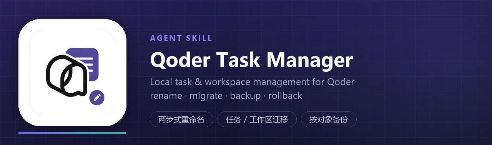
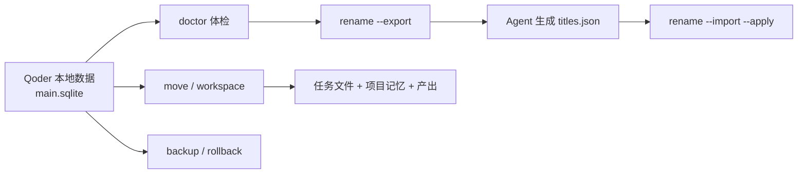

<p align="center">
  
</p>

<p align="center">给 AI Agent 用的 Qoder 本地任务管理技能</p>

<p align="center">
  <a href="https://github.com/HuaHua-Technophile/qoder-conversation-manager/releases"></a>
  <a href="https://www.python.org/"></a>
  <a href="#"></a>
  <a href="LICENSE"></a>
  <a href="https://skillhub.cn/skills/user_3c4d2464/qoder-conversation-manager"></a>
</p>

<p align="center"><sub>repo / slug: <code>qoder-conversation-manager</code></sub></p>

<p align="center">
  <a href="#安装">安装</a> ·
  <a href="#快速开始">快速开始</a> ·
  <a href="#命令总览">命令</a> ·
  <a href="#安全设计">安全</a> ·
  <a href="#开发">开发</a> ·
  <a href="#文档">文档</a>
</p>

一个给 AI Agent 用的技能：管理本机 **Qoder** 的任务与工作区——七项体检、六维筛选、按完整任务历史两步式重命名、跨工作区迁移（连同文件、项目记忆和产出）、工作区增删改、整库备份与回滚。

> A portable agent skill for managing local **Qoder** tasks and workspaces: doctor, list/filter, two-step rename from full transcripts, move between workspaces with files and memory, backup & rollback.

---

## 为什么需要它

Qoder 自带的命名只取「首条用户消息 + 首条助手回复」，长任务真正的落点往往在中后段：

| 处理前 | 处理后 |
|---|---|
| `在本机（HUAHUA-PC）把工具包里的旧 Win11 精简版镜像换成新镜像` | `[硬件] 更新 Win11 精简镜像并校验启动项` |
| `请您根据今日公…` | `[数据] 汇总当日公开数据并产出三份报表` |

更麻烦的是「换工作区」不只是改一个字段。Qoder 的正文路径由 `cwd` 推导，数据库归属、会话 JSONL、同名子目录、项目级记忆、产出文件都要一起处理，否则应用重启后可能读不到历史、记忆丢失或链接失效。

这个技能把「读完整历史 → 生成准确标题 → 安全写回」和「改归属 + 搬全套文件」变成可重复、可回滚的流程，并默认先干跑、按对象备份。

## 工作流



## 亮点

- **两步式重命名**：`rename --export` 导出完整历史，Agent 生成 `titles.json`，`rename --import` 写回；默认只打印计划，`--apply` 才落盘。
- **自动分片**：按字数做 LPT 均衡分片，大批量任务可交给多个子智能体并行处理。
- **真迁移**：`move` 默认搬会话 JSONL、同名子目录、该任务写入的项目记忆与产出；旧路径留硬链接，历史链接不断。
- **七项体检**：数据库、WAL、表结构、进程、工作区路径、影子任务、备份；`--deep` 再加查会话文件、目录一致性、项目记忆、产出索引。
- **安全兜底**：每条任务独立事务，失败只影响它自己；目标文件重名先备份；搬空的源目录自动清理。
- **可演练**：`--db` 指向数据库副本时，不要求 Qoder 退出，可完整跑 rename / move / rollback。

## 安装

技能是纯目录 + Python 标准库脚本，不需要 `pip install`。仓库按 `skills/<技能名>/` 组织（便于 skills.sh 这类目录索引），而宿主要求技能根目录直接是 `SKILL.md`，所以用脚本摊平安装：

```bash
git clone https://github.com/HuaHua-Technophile/qoder-conversation-manager.git
cd qoder-conversation-manager

python install.py                 # 装到 ~/.workbuddy/skills
python install.py --to ~/.qoder/skills
python install.py --targets all   # WorkBuddy / Qoder / .agents 三处都装
```

也可以直接复制技能目录：

```bash
cp -r skills/qoder-conversation-manager "$HOME/.workbuddy/skills/"
```

安装后验证：

```bash
python "$HOME/.workbuddy/skills/qoder-conversation-manager/scripts/qoder_sessions.py" doctor
```

## 快速开始

以下命令在已安装的技能目录执行（`cd ~/.workbuddy/skills/qoder-conversation-manager`）。

```bash
# 1. 体检
python scripts/qoder_sessions.py doctor

# 2. 看看有哪些任务
python scripts/qoder_sessions.py list --limit 20

# 3. 导出完整历史（默认全部活跃任务；大批量加 --shards 做均衡分片）
python scripts/qoder_sessions.py rename --export --shards 6 --out ./exp

# 4. 让 Agent 读 ./exp/*.txt，产出 titles.json，然后先干跑
python scripts/qoder_sessions.py rename --import titles.json

# 5. 确认无误后落盘
python scripts/qoder_sessions.py rename --import titles.json --apply
```

`titles.json` 格式：

```json
[
  {"sid": "e3d0af7b-8f30-40a9-a5aa-08b000dc0b3d", "new_title": "把任务迁移技能传到笔记本", "category": "系统"},
  {"sid": "2dd673fa", "new_title": "排除代理误判定位 RDP 链路丢包"}
]
```

`sid` 支持完整 UUID 或前 8 位；`new_title` 可不带前缀，`category` 会自动补成 `[分类] 标题`。标题默认长度 **20–30 字**，可用 `--min-title-len` / `--max-title-len` 调整。

## 迁移与工作区

```bash
# 迁移：按条件批量（先干跑，确认后加 --apply）
python scripts/qoder_sessions.py move --to Cross-Platform --filter "cwd contains NAS"
python scripts/qoder_sessions.py move --to Cross-Platform --filter "cwd contains NAS" --apply

# 只要元数据，不搬文件与记忆
python scripts/qoder_sessions.py move --to VMs --ids 6ed7f61f --metadata-only --apply

# 工作区维护
python scripts/qoder_sessions.py workspace list
python scripts/qoder_sessions.py workspace new --name VMs --path D:/VMs --apply
python scripts/qoder_sessions.py workspace retarget --name VMs --path D:/VM2 --apply
python scripts/qoder_sessions.py workspace delete --name VMs --yes --apply

# 备份与回滚
python scripts/qoder_sessions.py backup --list
python scripts/qoder_sessions.py rollback --backup ./qoder-cm-backups/db/<快照> --yes --apply
```

所有命令支持 `--json` 输出结构化结果，方便 agent 解析。

## 命令总览

| 命令 | 用途 | 写库 |
|---|---|---|
| `doctor` | 七项体检；`--deep` 加查会话文件、目录一致性、项目记忆、产出索引 | 否 |
| `list` | 六维筛选：关键词 / 工作区 / cwd / 时间 / 标题来源 / 影子 | 否 |
| `rename --export` | 导出完整历史，按字数 LPT 自动分片 | 否 |
| `rename --import` | 写回标题并锁定来源标记；默认干跑，`--apply` 落盘 | 是 |
| `move` | 迁移任务：归属 + 会话文件 + 项目记忆 + 产出 | 是 |
| `workspace` | `list` / `new` / `rename` / `retarget` / `archive` / `unarchive` / `delete` | 部分 |
| `repair` | 补齐历史上「只改库、没搬文件」的任务 | 文件 |
| `backup` / `rollback` | 整库快照与恢复（单条 / 整批） | 是 |

**不做**：不删任务（只做工作区级联软删除）、不改任务正文、不动全局记忆 `~/.qoder/memory/`、不操作另一台设备的影子任务。

## 安全设计

- **默认 dry-run**：所有写命令不加 `--apply` 只打印计划。
- **允许热写**：Qoder 运行中也能写（WAL 保证一致性），写完重启做一次验证；要硬性拦截加 `--require-closed`。
- **按对象备份**：每条被改动的任务单独存完整行，支持单条（`rollback --manifest`）或整批（`rollback --batch`）回滚；破坏性操作另做整库快照，保留最近 10 份。
- **每条独立事务**：批量操作某条失败不影响其余，结束时按成功/失败计数返回退出码。
- **迁移是全量的**：默认连会话文件、项目记忆、产出一起搬；产出旧路径留硬链接。
- **影子任务一律拒绝**：`peerOriginSessionId` 非空的任务正文在另一台设备，改了会被同步覆盖。
- **只操作本地工作区**：同名工作区解析优先取本地那份。
- **删除只做软删除**（进 Qoder 回收站），且必须 `--yes`。
- **副本演练**：`--db` 指向副本时不要求 Qoder 退出，可完整跑全流程。

## 开发

仓库即源码，改完推上去自动发布：

```bash
git tag -a vX.Y.Z -m "vX.Y.Z — 摘要"
git push origin vX.Y.Z     # GitHub Release + SkillHub 自动完成
```

三处版本号（`SKILL.md`、`qoder_sessions.py`、`build_pkg.py`）必须一致，CI 会校验。完整流程、本地测试方法、踩坑记录见 [`DEVELOPMENT.md`](DEVELOPMENT.md)。

## 文档

| 文件 | 内容 |
|---|---|
| [`DEVELOPMENT.md`](DEVELOPMENT.md) | 开发与发布流程：改哪、怎么测、怎么发 |
| [`SKILL.md`](skills/qoder-conversation-manager/SKILL.md) | 技能主文档：完整命令、工作流、安全规则 |
| [`references/qoder-storage.md`](skills/qoder-conversation-manager/references/qoder-storage.md) | 表结构、路径编码、写入约定、验证 SQL、已知坑 |
| [`references/subagent-playbook.md`](skills/qoder-conversation-manager/references/subagent-playbook.md) | 大批量重命名的子智能体切片与派活模板 |
| [`references/cases.md`](skills/qoder-conversation-manager/references/cases.md) | 真实案例：27 条重命名、13 条跨工作区迁移 |
| [`references/install.md`](skills/qoder-conversation-manager/references/install.md) | 三端安装与验证 |
| [`CHANGELOG.md`](skills/qoder-conversation-manager/CHANGELOG.md) | 版本记录 |
| [`PUBLISHING.md`](skills/qoder-conversation-manager/PUBLISHING.md) | 各渠道发布状态、CLI 发布与 CI 自动化 |

## 环境要求

- Python 3.9+
- Qoder（Windows），已登录并产生过任务
- 对 `%APPDATA%\com.qoder.app.stable\` 的读写权限

## 已知限制

- 仅支持 **Windows**（路径探测按 Windows 实现）。
- 不支持操作另一台设备的 Qoder 数据；影子任务会被拒绝。
- 不改任务正文，不重建 FTS 索引（标题不在索引内，无需重建）。
- 本地工作区的 `execution_target_json.workspace.id` 是 `ws_<64位哈希>`，算法不可复现；技能采用「复用目标工作区已有值，新工作区退回 UUID」的策略。

## 发布

| 渠道 | 状态 | 入口 |
|---|---|---|
| GitHub | 已发布，含两个 zip | [Releases](https://github.com/HuaHua-Technophile/qoder-conversation-manager/releases) |
| SkillHub | 已上架 | [详情页](https://skillhub.cn/skills/user_3c4d2464/qoder-conversation-manager) |
| WorkBuddy 开放平台 | 手动更新 | [控制台](https://open.workbuddy.cn/skill/all) |
| skills.sh | 按仓库自动索引 | 无手动入口 |

仓库已接入 [`.github/workflows/release.yml`](.github/workflows/release.yml)：push `v*` tag 自动校验版本、构建 zip、发 GitHub Release，并同步发布到 SkillHub。WorkBuddy 开放平台无 API / CLI，只能手动上传 `-dir` 包。

## License

[MIT](LICENSE)
